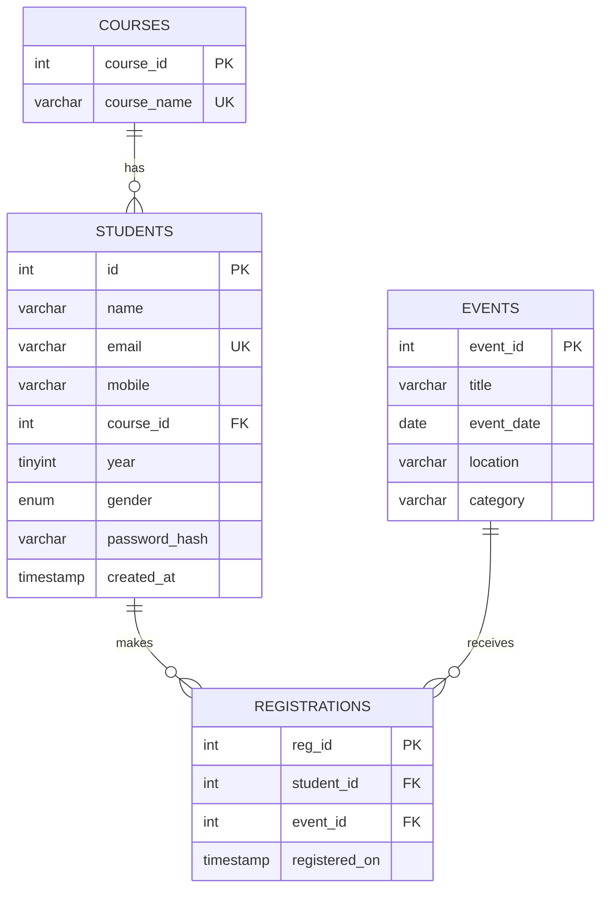

# StudentHub Practical 8 ER Model

One course can have many students. Students and events have a many-to-many
relationship, represented by `registrations`. The unique pair
(`student_id`, `event_id`) prevents duplicate sign-ups. Course names are stored
once in `courses`; the student table stores only the course key.

The SQL file creates the lab database as `studenthub_practical8` so it can be
imported alongside an existing StudentHub database without overwriting it.
